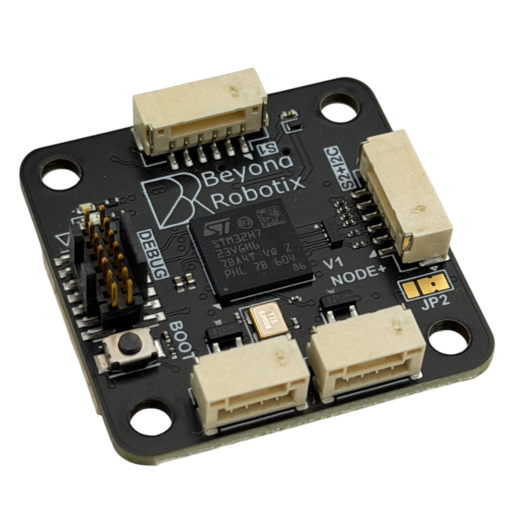
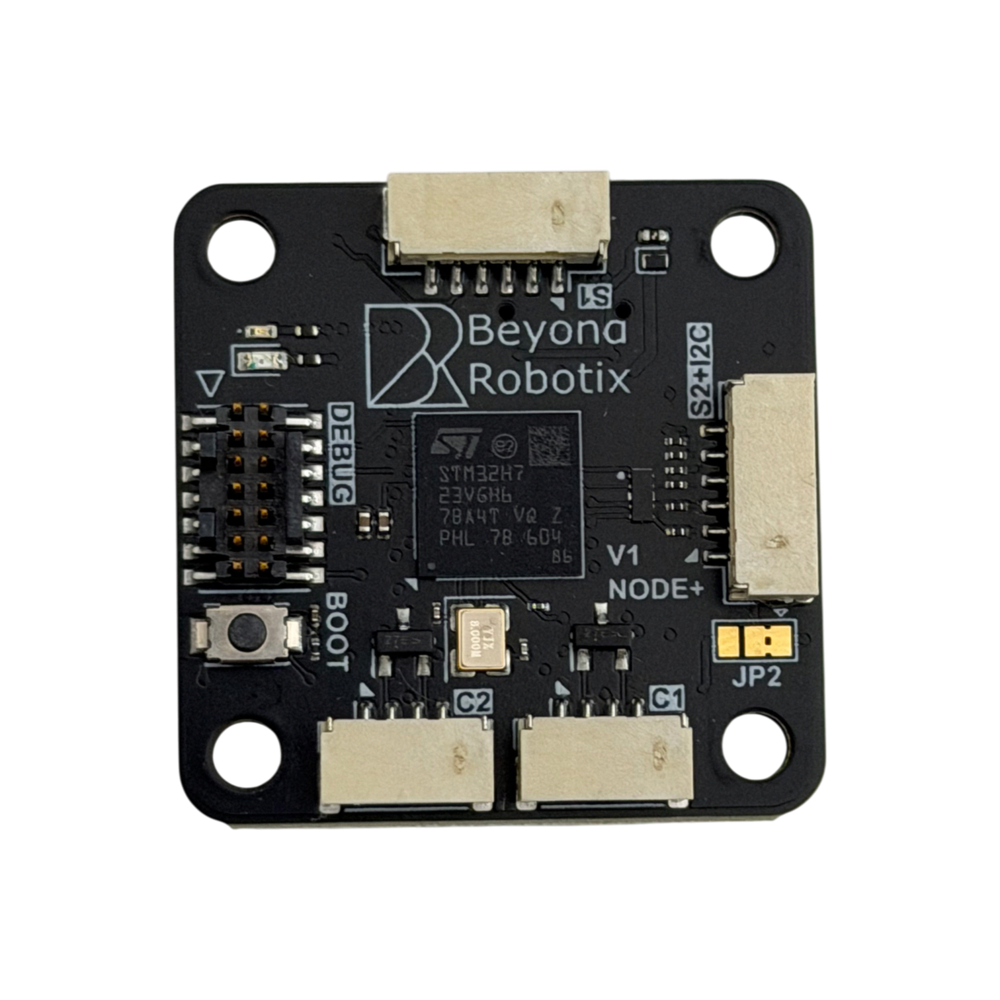
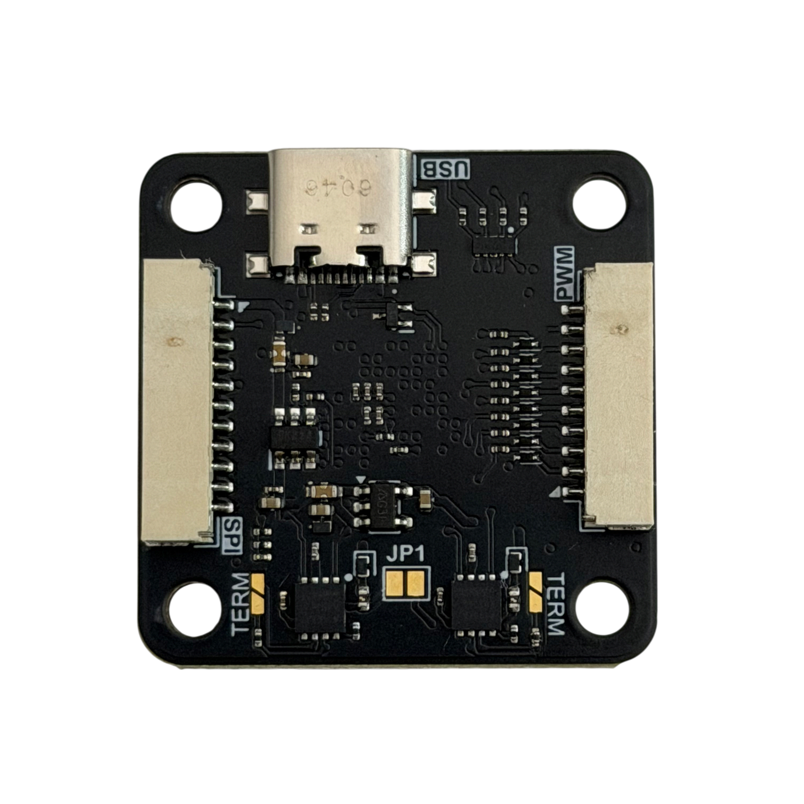
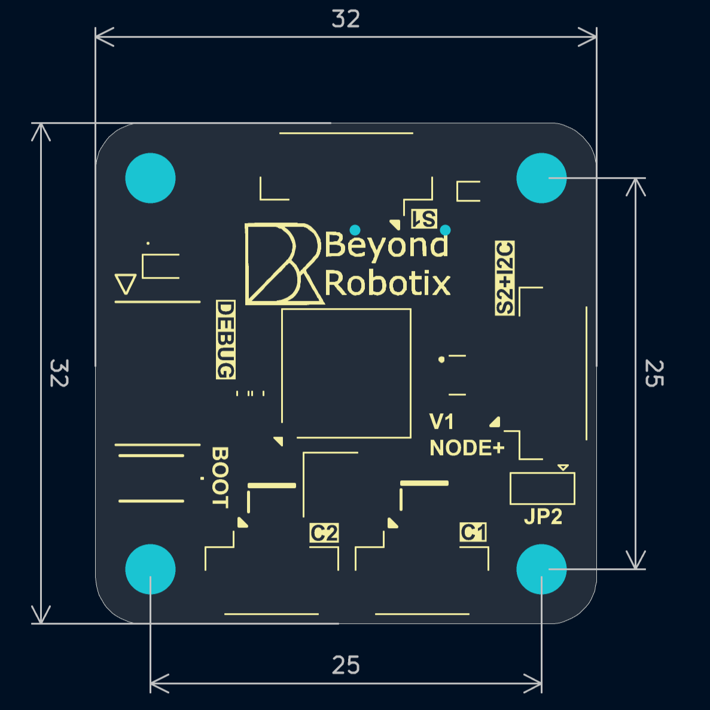
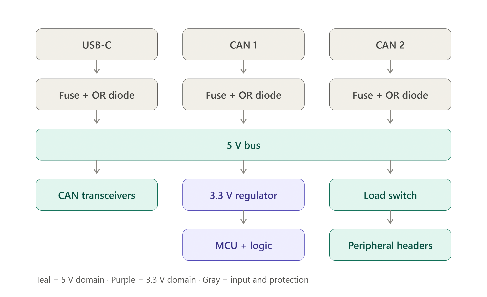

# CAN Node Plus

## Overview

The CAN Node Plus steps up from our L431 nodes to an STM32H723. It brings two fully independent CAN FD interfaces, considerably more processing power, and a set of JST-GH connectors following the same conventions as an autopilot, so standard peripherals plug straight in.

Like the rest of the range it runs [Arduino DroneCAN](arduino-dronecan/), so you write a normal Arduino sketch and get DroneCAN, parameters and firmware update over CAN for free. It also runs [AP\_Periph](#firmware), ArduPilot's ready-made DroneCAN peripheral firmware, for when no custom firmware is needed.

<figure><figcaption></figcaption></figure>



* STM32H723VGHx processor - 550 MHz Cortex-M7, 1 MB flash
* **2x independent CAN FD interfaces**, each with its own transceiver and its own JST-GH connector
* Optional 120 ohm termination on each CAN interface, via a solder jumper
* USB-C
* SWD + serial debug header for easy Arduino DroneCAN development
* JST-GH connector interfaces
  * 2x CAN
  * 1x Serial with flow control
  * 1x Serial + I2C combined, in the same pinout an autopilot uses for GPS
  * 1x SPI, with two chip selects and two data ready lines
  * 1x PWM, 8 channels
* On-board I2C pull-up resistors
* 5V peripheral rail is current limited to about 540 mA, and can be switched off in software
* Input voltage monitoring
* BOOT0 button
* Power input from either CAN connector or from USB, each individually fused
* 32 x 32mm, with 4x M3 mounting holes on a 25 x 25mm square

<div><figure><figcaption><p>Top - the two CAN connectors (<code>C1</code>, <code>C2</code>), Serial 1 (<code>S1</code>), Serial 2 + I2C (<code>S2+I2C</code>), the debug header and the BOOT button</p></figcaption></figure> <figure><figcaption><p>Bottom - USB-C, SPI, PWM, the <code>JP1</code> power bridge and the two <code>TERM</code> termination jumpers</p></figcaption></figure></div>

## Firmware

The board is primarily designed to be used with our **Arduino DroneCAN** library, so you can write your own firmware around your sensor with minimal boilerplate. It can also run **AP\_Periph**, ArduPilot's ready-made DroneCAN peripheral firmware, for when no custom firmware is needed.

Both firmwares sit behind the same Beyond Robotix bootloader, so you can switch between them over CAN without an ST-LINK.

### Arduino DroneCAN

Build for the CAN Node Plus by selecting the `Micro-Node-Plus-App` environment in PlatformIO. Everything else works the same as on the rest of the range, with two additions this board is capable of: CAN FD, and running both CAN interfaces at once.


[arduino-dronecan](arduino-dronecan/)


### AP\_Periph

AP\_Periph requires no code and supports a wide range of common sensors out of the box. The board definition is `BR_CANNodePlus`.

#### Default firmware features

* **CAN** - both CAN interfaces run DroneCAN at the same time, node name `org.beyondrobotix.CANNodePlus`
* **GPS** - u-blox, NMEA and other serial GPS on [Serial 2 + I2C](#serial-2-and-i2c), with moving baseline support
* **Compass** - probed on the Serial 2 + I2C bus, so a GPS/compass module works from the one connector
* **Barometer and airspeed** - I2C sensors
* **Rangefinder** - compiled in, disabled by default
* **Servo/PWM output** - 8 channels, see [PWM outputs](#pwm-outputs) below
* **Relay output**
* **Serial over DroneCAN** - any serial port can be tunnelled over CAN, for example to configure a GPS from the ground station through the autopilot
* **Input voltage monitoring** - the 5V bus on `PB1`

#### Serial ports

| Connector | Port | Default use |
| --------- | ---- | ----------- |
| USB-C | `SERIAL0` | Console |
| Serial 1 (`S1`) | `SERIAL1` | Free, with flow control (`UART1_RTSCTS`) |
| Serial 2 + I2C (`S2+I2C`) | `SERIAL2` | GPS (`GPS_PORT` = `2`) |
| Debug header | `SERIAL3` | Free. TX and RX are swapped on the board, `UART3_OPTIONS` is `8` by default to swap them back |

Set `GPS_PORT` to a different serial port number to move the GPS, for example `1` for Serial 1.

#### PWM outputs

| Connector pin | Processor pin | Output (`OUTn_`) | GPIO |
| ------------- | ------------- | ---------------- | ---- |
| 2 | PA3 | 1 | 50 |
| 3 | PA2 | 2 | 51 |
| 4 | PA1 | 3 | 52 |
| 5 | PE13 | 4 | 53 |
| 6 | PA9 | 5 | 54 |
| 7 | PA8 | 6 | 55 |
| 8 | PC7 | 7 | 56 |
| 9 | PC6 | 8 | 57 |

Outputs 1-3 are driven by TIM2, outputs 4-6 by TIM1 and outputs 7-8 by TIM3. Outputs on the same timer share a rate and protocol.

| Parameter               | Purpose                                      | Notes                                                                                             |
| ----------------------- | -------------------------------------------- | ------------------------------------------------------------------------------------------------- |
| `OUTn_FUNCTION`         | Assigns output function to channel _n_ (1-8) | `0` = Disabled. See `SRV_Channel::Aux_servo_function_t` for full list (e.g. Motor1, RCIN1, GPIO). |
| `OUTn_MIN` / `OUTn_MAX` | PWM endpoint range (µs)                      | Per channel                                                                                       |
| `OUTn_TRIM`             | Trim/neutral PWM (µs)                        | Per channel                                                                                       |
| `OUTn_REVERSED`         | Reverse output direction                     | Per channel                                                                                       |
| `ESC_RATE`              | Update rate for ESC/motor outputs            | Default 400 Hz                                                                                    |
| `ESC_PWM_TYPE`          | Output protocol (OneShot/DShot/etc.)         | Default 0 (normal PWM)                                                                            |

#### Other GPIO

| Processor pin | GPIO | Use |
| ------------- | ---- | --- |
| PA5 | 80 | [5V peripheral rail](#the-5v-peripheral-rail) enable, on by default. Set low with a relay to cut power to the peripheral connectors |
| PB0 | 90 | Green LED |

#### Firmware files and flashing

The CAN Node Plus keeps the Beyond Robotix bootloader with both firmwares. There is no AP\_Periph bootloader for this board and no "with bootloader" file - only the `.bin` application.

**Over CAN** - from a board already running AP\_Periph or Arduino DroneCAN, update the node with the `.bin` file in the usual way through Mission Planner's DroneCAN page (or the DroneCAN GUI Tool). The node hands over to the bootloader, which downloads and starts the new firmware.

**With an ST-LINK** - flash the `.bin` at address `0x08020000`, for example with STM32CubeProgrammer. Do not erase the whole chip or write to `0x08000000`, as that is where the bootloader lives.

```
openocd -f interface/stlink.cfg -f target/stm32h7x.cfg \
  -c "program can-node-plus-ap-periph.bin 0x08020000 verify reset exit"
```



If the bootloader is ever lost, flash `bootloader.bin` from the `variants/MicroNodePlus` folder of [br\_platformio\_hwdef](https://github.com/BeyondRobotix/br_platformio_hwdef) at `0x08000000` with an ST-LINK, or over USB using [DFU](#dfu), then load the application again.

The source is the `BR_CANNodePlus` board in our [ArduPilot fork](https://github.com/BeyondRobotix/ardupilot/tree/CAN-Node-Plus-Periph/libraries/AP_HAL_ChibiOS/hwdef/BR_CANNodePlus). To build it yourself:

```
./waf configure --board BR_CANNodePlus
./waf AP_Periph
```

For general background on AP\_Periph on our nodes, see:


[ap-periph.md](ap-periph.md)


## Mechanical

### CAD

Full CAD including connectors can be found here:



### Mounting holes & Board dimensions

The board is 32 x 32mm, with the four mounting holes on a 25 x 25mm square. Mounting holes are M3 (3.2mm diameter cutout).

Dimensions in mm:

<figure><figcaption></figcaption></figure>

## Power

The board takes power from three places: CAN1, CAN2 and USB. Each one goes through its own 1 A fuse and then its own diode onto a single internal 5V bus, so the three are OR'd together rather than switched between - whichever input is highest at the time carries the load. The diodes double as reverse protection on each input.

Everything on the board runs from that shared bus: both CAN transceivers, the 3.3V regulator that supplies the processor, and the switched 5V rail that feeds the peripheral connectors.

<figure><figcaption><p>Three fused and OR'd inputs onto one 5V bus</p></figcaption></figure>

### Redundancy

The OR'ing is passive, which is what makes it useful on a vehicle where the node has to stay up:

* **Either CAN connector can power the whole board**, both transceivers included. A node wired to two buses keeps running, on both interfaces, when one bus loses power.
* **Changeover is instant and needs no firmware.** There is no switching logic to configure, and none to fail - if the input carrying the load disappears, the next highest simply takes over.
* **A fault on one input can't propagate.** That input's fuse blows on its own, and its diode blocks the fault from back feeding, so a shorted CAN harness can't drag down the other bus or the flight controller's rail.
* **A second supply can be connected or removed while the node is running**, without disturbing the one already carrying it.


The two CAN connectors are separately fused, so by default 5V does **not** pass between them - a peripheral plugged into one won't be fed from the other. `JP1`, on the underside between the two CAN transceivers, bridges them if you want to daisy chain power through the node.

`JP1` joins the two connector pins directly, ahead of both fuses. The node's own supply stays fused either way, but current passing straight through from one connector to the other is not, so size the protection upstream accordingly.


### Powering from a flight controller on USB


**A flight controller running on USB alone may not power the node well enough to transmit CAN frames.**

Each CAN input passes through a protection diode, which drops the incoming voltage. A flight controller powered only over USB already puts out a reduced 5V on its CAN connectors, and after our diode the rail can end up below what the CAN transceivers need to drive the bus. The node powers up and runs, so it looks fine, but frames don't go out and it never appears on the bus.

Either of these fixes it:

* Plug USB into the CAN Node Plus as well, so the node has its own supply
* Power the flight controller properly, through `POWER1` or `POWER2`, which brings the CAN rail back up

This bites most often on the bench, where a flight controller on a USB cable is the natural way to work. On a vehicle with a power module fitted it doesn't arise.


### The 5V peripheral rail

The peripheral connectors - Serial 1, Serial 2 + I2C, SPI and PWM - aren't fed from the shared bus directly. They come off it through a current limited load switch. If a sensor shorts, the switch limits the current rather than letting it pull the bus down, so the processor keeps running and the node stays on CAN. A failed peripheral doesn't take the node off the bus with it.

**The limit is about 540 mA**, shared across all four connectors - so a GPS on Serial 2 + I2C and a servo rail on PWM are drawing from the same allowance. That sits inside the 1 A input fuse, with the node's own consumption to fit alongside it, so a peripheral taking its full share won't cost you the input. Anything hungrier than the rail can supply wants its own power, not the node's.

Note that `JP2` takes Serial 2 + I2C pin 1 off this rail: in the 3.3V position that pin is fed from the 3.3V regulator that also supplies the processor, so it is neither switched by `PA5` nor covered by the 540 mA limit.

The enable line is `PA5`, held high by a pull-up, so the rail is live as soon as the board is powered and firmware doesn't have to switch it on. Drive it low to cut peripheral power:

```cpp
pinMode(PA5, OUTPUT);
digitalWrite(PA5, LOW);   // peripheral 5V off
digitalWrite(PA5, HIGH);  // and back on
```

That gives you a way to power cycle a hung sensor in flight, without power cycling the vehicle.


The load switch's fault output isn't wired to the processor, so firmware can't be told that the limit has tripped. An overcurrent shows up as the peripheral going quiet, not as a flag you can read.


### Monitoring the input voltage

The 5V bus is brought to `PB1` through a 10k/10k divider, so a reading on `PB1` is half the bus voltage. Reporting that over DroneCAN is a cheap way to catch a supply that is sagging - which, as above, is what a node that powers up but won't transmit looks like.

## Pinout / Interfaces

### CAN

Two entirely separate CAN FD interfaces, each with its own transceiver and connector. They are not two connectors on one bus - see [two CAN ports](arduino-dronecan/#two-can-ports) for how to use both from one program.

Both connectors are on the bottom edge of the top side, marked `C1` and `C2`, and share the same pinout:

If the node runs but never appears on the bus, check how the other end is powered - see [powering from a flight controller on USB](#powering-from-a-flight-controller-on-usb).

| Pin | Description |
| --- | ----------- |
| 1   | Vcc (5V)    |
| 2   | CANH        |
| 3   | CANL        |
| 4   | GND         |

Each interface has its own 120 ohm termination resistor, fitted by bridging a solder jumper. The jumpers are on the underside of the board, one beside each CAN transceiver, both marked `TERM`. Both are open by default, so terminate only the nodes at the two ends of your bus.

### Serial 1

Serial with flow control, in the same pinout an autopilot uses for telemetry. Marked `S1` on the board, and available in your code as `Serial1`.

| Pin | Description | Processor pin |
| --- | ----------- | ------------- |
| 1   | Vcc (5V)    |               |
| 2   | TX          | PD5           |
| 3   | RX          | PD6           |
| 4   | CTS         | PD3           |
| 5   | RTS         | PD4           |
| 6   | GND         |               |

### Serial 2 & I2C

Serial and I2C brought out on one connector, in the same pinout an autopilot uses for GPS - so a GPS + compass module plugs straight in. Marked `S2+I2C` on the board, and available in your code as `Serial2` and `Wire`.

| Pin | Description | Processor pin |
| --- | ----------- | ------------- |
| 1   | Vcc         |               |
| 2   | TX          | PC10          |
| 3   | RX          | PC11          |
| 4   | SCL         | PB10          |
| 5   | SDA         | PB11          |
| 6   | GND         |               |

I2C pull-up resistors are fitted on the board, so I2C sensors work without adding your own.


Pin 1 of this connector is 5V by default, from the switched [peripheral rail](#the-5v-peripheral-rail). `JP2`, on the top side just below the connector, switches it to 3.3V if your peripheral needs that instead - which also takes it off that rail, onto the processor's own 3.3V regulator.


### SPI

Two chip selects, two data ready inputs, plus sync and reset lines. On the underside of the board, and available in your code as `SPI`, with the control lines as named pins.

| Pin | Description | Processor pin | In your code |
| --- | ----------- | ------------- | ------------ |
| 1   | Vcc (5V)    |               |              |
| 2   | SCK         | PE2           | `SPI`        |
| 3   | MISO        | PE5           | `SPI`        |
| 4   | MOSI        | PE6           | `SPI`        |
| 5   | CS1         | PD15          | `SPI_CS1`    |
| 6   | CS2         | PD14          | `SPI_CS2`    |
| 7   | SYNC        | PD13          | `SPI_SYNC`   |
| 8   | DRDY1       | PD12          | `SPI_DRDY1`  |
| 9   | DRDY2       | PD11          | `SPI_DRDY2`  |
| 10  | nRESET      | PD10          | `SPI_nRESET` |
| 11  | GND         |               |              |

The chip select, data ready, sync and reset lines are plain GPIO - drive or read them yourself, for example `digitalWrite(SPI_CS1, LOW)`.

### PWM

8 PWM channels on one connector, on the underside of the board opposite the SPI connector.

| Pin | Description | Processor pin | In your code |
| --- | ----------- | ------------- | ------------ |
| 1   | Vcc (5V)    |               |              |
| 2   | PWM 1       | PA3           | `PWM1`       |
| 3   | PWM 2       | PA2           | `PWM2`       |
| 4   | PWM 3       | PA1           | `PWM3`       |
| 5   | PWM 4       | PE13          | `PWM4`       |
| 6   | PWM 5       | PA9           | `PWM5`       |
| 7   | PWM 6       | PA8           | `PWM6`       |
| 8   | PWM 7       | PC7           | `PWM7`       |
| 9   | PWM 8       | PC6           | `PWM8`       |
| 10  | GND         |               |              |


Use the names rather than the processor pins in your code - `analogWrite(PWM1, value)` - and the numbering follows the connector.


## Programming the board

### ST-LINK

STM32 allows the ability to easily debug programs over SWDIO. This allows live variable inspection, breakpoints and more - which makes program development much easier!

The debug header carries SWD, reset, and a serial console which appears in your code as `Serial`. To upload code:

1. Connect the node to your ST-LINK
2. Click upload or debug in VS-Code!

The header is shrouded and keyed, so the cable only fits one way round - there is no pin 1 to line up by eye.

| Pin | Description |
| --- | ----------- |
| 1   | NC          |
| 2   | NC          |
| 3   | 3.3V        |
| 4   | SWD         |
| 5   | GND         |
| 6   | SWC         |
| 7   | GND         |
| 8   | NC          |
| 9   | NC          |
| 10  | NC          |
| 11  | GND         |
| 12  | NRST        |
| 13  | Debug UART RX (into the node) |
| 14  | Debug UART TX (out of the node) |


Pin 3 is **3.3V**, not 5V as on the Micro Node debug header - this header will not power the board. Power the node over CAN or USB while debugging.


### DFU

There is a BOOT0 button on the board. Holding it while resetting the node starts the processor's built in bootloader, which can be used to recover a board over USB if the bootloader is ever lost.
